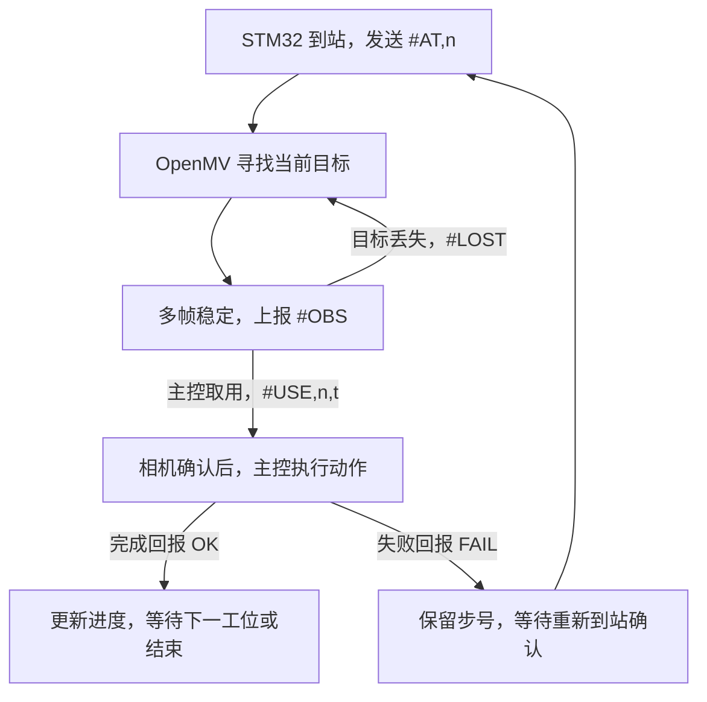

# OpenMV H7 Plus 智能搬运视觉系统

小车到达转盘时，OpenMV 要判断**当前该抓哪种颜色，以及这件物料是否已经停在夹爪前**。到达粗加工区或暂存区后，相机再寻找指定数字环或同色底座。 OpenMV 从二维码生成两批任务，用相机找到当前目标，再通过串口把目标中心发给 STM32F4。底盘移动、机械手抓放由 STM32 执行，OpenMV 收到动作完成回执后才推进任务并更新屏幕计数。

**当前联调范围**　随项目提供的 V5 主控程序执行到第一批三件抓取完成。此时相机显示 `WAIT`、`PICK 3 PUT 0`，符合当前程序逻辑。第 4–25 步的视觉处理已写在 OpenMV 端，继续运行需要主控发送对应的到站和动作回执。

## 一、一次比赛怎样运行

开机后，相机以 **320 × 240、RGB565** 采图，预热后锁定增益和白平衡，屏幕显示 `READY`。STM32 到达码板前发 `R`，OpenMV 才开始扫码。主循环每轮先处理串口命令，再采一帧图像，按当前工位决定找物料、数字环还是蓝色启停区。

以任务码 **`156+123+516+231`** 为例。第 1、3 组分别是两批的颜色和取料顺序，第 2、4 组分别指定两批的粗加工环号。颜色编号为 1 红、2 黄、3 蓝、4 绿、5 黑、6 浅蓝。

| 车到哪里、做什么 | 第一批 | 第二批 |
|---|---|---|
| 原料区，从转盘逐件取料上车 | 第 1–3 步：红、黑、浅蓝 | 第 13–15 步：黑、红、浅蓝 |
| 粗加工区，把物料放到指定空环 | 第 4–6 步：红放 1 号，黑放 2 号，浅蓝放 3 号 | 第 16–18 步：黑放 2 号，红放 3 号，浅蓝放 1 号 |
| 粗加工区，从刚才的环位取回物料 | 第 7–9 步：取 1 号红、2 号黑、3 号浅蓝 | 第 19–21 步：取 2 号黑、3 号红、1 号浅蓝 |
| 暂存区，将物料放到最终位置 | 第 10–12 步：按 1、2、3 号环放好红、黑、浅蓝，形成底层 | 第 22–24 步：黑叠在 2 号黑底座，红叠在 1 号红底座，浅蓝叠在 3 号浅蓝底座 |

**第二批红料在粗加工区放 3 号，在暂存区叠 1 号。** 程序在扫码时就建立了“第一批颜色 → 暂存环号”的映射，因此能在第二批码垛时按颜色找回底座。

第 25 步是返程。相机在画面中寻找面积达到阈值的唯一蓝色区域，报告其中心。场上有两个蓝色启停区，回到抽签指定起点由主控定位确认。全部动作成功回执后，屏幕显示 `DONE`，抓取和放置各计 12 次。

## 二、相机如何识别目标

### 1. 扫码并生成任务表

`Mission.scan()` 将画面转为灰度，调用 `find_qrcodes()` 解码。程序检查是否恰有四组三位数、每批颜色是否互不重复且两批颜色集合相同，以及两组环号是否各为 1、2、3 的排列。默认连续三帧读到同一个、唯一的合法码才接受。随后 `Mission.make_plan()` 生成 24 个抓放动作和 1 个返程步骤，并通过 `#SEQ` 上报任务码。

### 2. 在转盘上找出可以抓的一件

| 判断 | 算法怎样做 | 得到什么 |
|---|---|---|
| 画面里哪里像物料？ | `MaterialDetector` 用六组 LAB 颜色阈值找连通色块，按面积、边长和填充率筛选。在候选色块附近用霍夫圆检测（`find_circles()`）找物料圆顶，再复核圆心小区域的颜色。 | 候选物料的颜色、顶面中心和半径。复核中心颜色有助于排除白底黑环被当作黑料的情况。 |
| 转盘和夹取工位在哪里？ | `DiskGate` 用三种不同颜色近似相隔 120° 的布局估计盘心，再用盘沿内外亮度差和盘芯亮区验证。锁盘后按 **200/300** 的轨迹直径比，在盘心朝夹爪的方向计算固定工位。 | `#SLOT` 给出夹取工位中心和盘半径。已经取走一两件时，可在上一次确认的盘位附近重新找盘。 |
| 当前目标停稳了吗？ | `MaterialTracker` 在相邻帧间按颜色和位置关联目标；`Track` 用两个一维卡尔曼滤波器分别估计横、纵位置和速度。`SourceStation` 核对目标颜色、停稳状态、实测圆心与工位的距离。 | 默认低速判定需持续 550 ms，同一目标进入夹取位置后还要保持 150 ms。首批只有主控已授权且工位对齐，才会收到 `#OBJ`。 |

图像坐标 `(u, v)` 的原点位于左上角，向右、向下为正，单位为像素。安装相机后，需要用实际可夹取位置标定 `PICK_TARGET_X/Y`；`PICK_DIRECTION_X/Y` 用来指定从盘心朝夹爪的方向。

### 3. 识别空环，以及数字被盖住的环

**放到空环时**，`RingDetector` 在灰度图里找暗色候选区域，沿多个方向采样，检查是否存在多道分开的同心暗环。它把环中央的数字缩成 **5 × 7** 黑白网格，与数字模板逐格比较。默认尝试 0°、90°、180°、270° 四个朝向；最佳得分及其相对第二名的差距都达标，才采用读数。画面中只有一个环匹配任务编号时，程序输出该环中心。

**从已占用的环取料或向上码垛时**，`StationVision` 要同时确认环位和物料颜色。若已为该工位配置 `COVERED_WINDOWS`，直接使用实测窗口；否则先尝试读取目标编号。若只有目标数字被挡，程序可借另外两个已知编号和等间距布局推算位置，并要求该处确实检测到第三个环沿。最后，窗口内必须只有一个符合条件的圆顶，且颜色与任务一致。

三个数字全被挡住时，实车需要可重复的停车姿态，以及提前测好的粗加工区、暂存区窗口。两区分别配置，每个窗口记录中心和半窗宽。

## 三、OpenMV 和 STM32 怎样配合

默认串口为 **UART3，115200，8N1**。首批取料沿用 V5 握手：OpenMV 报告 `#SLOT`，STM32 对齐停稳后发 `#ARM,1` 授权。相机找到可抓物料才发 `#OBJ`；主控开始抓取时发 `#TAKE`，收到 `#TAKE_OK` 后，待机械动作完成再发 `K`。**一次有效的 `K` 才增加一次抓取计数**。若机械手抓空却仍报告完成，相机仅凭该回执无法辨别。

第 4–25 步使用带步号和观测编号的握手。下图中 `n` 是当前任务步号，`t` 是这一次稳定观测的编号。

例如第 22 步，相机报告 `#OBS,22,17,STACK,STORE,5,2,158,122`，表示在暂存区 2 号位看到了黑色底座，圆顶中心是 `(158,122)`。主控发送 `#USE,22,17`，收到 `#USE_OK,22,17` 后执行码垛；确认放好再发 `#RESULT,22,17,OK`。观测过期时需重新识别，重发最近一次成功回执也只计一次。

## 四、从哪里读代码

| 文件 | 建议先看 | 负责的工作 |
|---|---|---|
| `openmv/main.py` | `run()`、`App.commands()`、`App.frame()` | 主循环、当前状态、选择识别工位、处理主控回执 |
| `openmv/tools.py` | `Mission`、`SourceStation`、`StationVision` | 从任务码生成步骤，调用转盘、物料和数字环识别对象；`Camera` 与 `Panel` 管理相机和显示 |
| `openmv/config.py` | `MATERIAL_THRESHOLDS`、`PICK_TARGET_X/Y`、`COVERED_WINDOWS` | 现场颜色阈值、夹取像素、遮号环位窗口，以及串口与超时参数 |
| `openmv/serial.py` | `SerialLink.poll()`、`SerialLink.send()` | 接收和拼接串口帧、解析命令、发送识别结果 |

当前验证覆盖电脑端任务规划、模拟串口握手和合成数字环图像。实车识别距离、颜色误判率、夹爪像素偏差和遮号工位的停车重复性仍需用本队相机及赛场物料测量。
