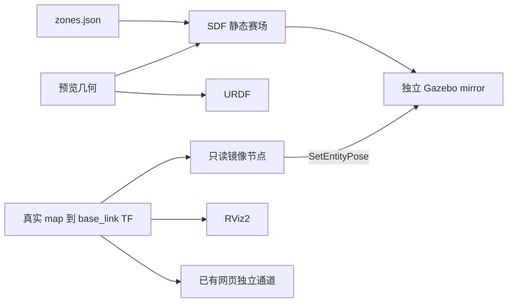

# 系统架构与所采用算法（源码对应版）

**基线**：`main@1a7a696b`，2026-11-22。本文区分 **当前真正运行的路径**、**已有但尚未接通的模块**、**旧 V5 历史路径**和 **模拟验证**。代码路径相对仓库根目录。

## 1. 分层与控制权

~~~mermaid
flowchart TB
  A[比赛任务与静态场地规则] --> B[ROS2 道路图 Dijkstra / 离线任务预览]
  C[雷达 /scan + TF] -.需实测定位与锁路.-> B
  B -.尚未授予实车执行权.-> D[未来 Pi 到 STM32 控制适配器]

  E[OpenMV H7 Plus: QR/颜色/圆盘/数字环] <-->|USART3 V4 ASCII| F[STM32F407: app_race / vision]
  F --> G[Race FSM / Pick FSM / RingAlign]
  G --> H[四轮速度环+位置环 / 舵机+步进]
  H --> I[实车麦轮与抓取机构]
  I --> J[编码器 / IMU]
  J --> F

  F -->|USART2 ULog43 单向遥测| K[Pi ROS2 car_stm32_bridge]
  K -->|/odom 等| L[REAL 只读网页]
  M[TEST mock MCU PTY / CAR-LINK] --> N[TEST ROS2 bridge] --> O[TEST 网页]
  P[浏览器 WASDQE] --> Q[localhost HTTP intent] --> R[PC ROS2 TwistStamped]
  R --> S[独立 ROS2 echo 订阅节点] --> T[MOCK 位姿积分] --> U[KEYBOARD 紫色车]
  V[浏览器五轴机构 MOCK] --> U
  W[SIM 本地模型] --> X[SIM 页面]
~~~

安全解释：

- **唯一已明确的真实执行者**是 STM32 固件自己的控制和机械流程。Pi/PC 的模拟任务、网页机构键、软件 ROS2 话题与“真实动作授权”是不同概念。
- `/real` 只接受真实来源的遥测；`/test` 与 `/real` 在 HTTP 内存通道和启动器中分离。网页安全隔离不构成密码学身份认证。
- `/keyboard` 的 `/car/teleop/local_test_twist` 用于 PC 上的软件回环。`/cmd_vel` 只读观察相关模块与测试并不意味着向实体 STM32 发送命令。
- 文档中的方框连线虚线代表**待实测/待开发**，不能当作已通的实体线。

## 2. STM32F407 / C30D 控制架构

### 2.1 业务、控制、驱动分层

| 层 | 主要文件 | 职责与边界 |
| --- | --- | --- |
| HAL 与调度 | `STM32F4/Core/Src/main.c`、`App/app_runtime.c` | 外设初始化、TIM6 时间基、主循环；不堆积视觉业务 |
| 轮电机 | `Control/Motor.c` | 编码器窗口测速、目标斜坡、PID/前馈/死区补偿、限幅、PWM 双路输出 |
| 麦克纳姆底盘 | `Control/mecanum_chassis.c` | 四轮正逆运动学、位置 PID、角度误差归一、世界/车体速度转换、里程计 |
| 航向/辅助里程计 | `Control/nav.c`、`Hardware/app_imu.c` | ICM20948 与轮式航向组合、打滑判断、静止零速修正 |
| 比赛总控 | `App/app_race.c`、`App/race_fsm.c`、`App/race_task_plan.c` | 启动/取消/故障/路线/二维码和夹取互斥 |
| 视觉帧 | `Hardware/vision.c/.h`、`Hardware/bsp_uart_router.c` | 唯一 USART3 HAL 回调路由、缓冲、XOR 帧验证和会话数据 |
| 圆环控制 | `App/app_ring_align.c` | 图像误差→车体小步、限幅、停稳/重测、超时与完成握手 |
| 机械抓取 | `App/app_pick_fsm.c`、`App/app_pick_motion.c` | PB14/PB15/PC7 舵机与 PC6/PC8/PC9 升降步进的非阻塞动作序列 |
| 日志 | `Hardware/bsp_ulog.c` / USART2 | ULog43 数值帧，一般作为只读遥测 |

### 2.2 实时周期

根据 [STM32 架构文档](../STM32F4/docs/ARCHITECTURE.md)：

~~~text
TIM6 1 ms：Motor_Update(每轮电机)
        └─ 累计 10 次：Mecanum_ChassisTick(10 ms 位置/速度目标)
主循环：IMU Poll → Vision_Poll → Race FSM → Pick FSM
      → 舵机/步进轮询 → 日志/显示，尽量非阻塞
~~~

注意不要把主机上能运行的 C 测试当成目标板已经稳定实现实际 1 ms 周期。串口中断里只做帧字节处理/转交，不能增加阻塞式识别或动作控制。

### 2.3 四麦轮运动学

源码 `Mecanum_InverseKinematics` 的约定中，车体纵向 `v_x`、横向 `v_y`、角速度 `ω`，`L = wheel_base_half + track_width_half`。四轮圆周线速度（先乘 `meter_to_pulse` 得到编码器脉冲每秒）是：

~~~text
v_LF = vx - vy - L*ω
v_RF = vx + vy + L*ω
v_LB = vx + vy - L*ω
v_RB = vx - vy + L*ω
~~~

逆推：

~~~text
vx = (v_LF + v_RF + v_LB + v_RB) / 4
vy = (-v_LF + v_RF + v_LB - v_RB) / 4
ω  = (-v_LF + v_RF - v_LB + v_RB) / (4L)
~~~

这是**当前源码符号约定**，真实车体的左右轮接线、电机方向宏和编码器方向仍要逐轮核对。`meter_to_pulse` 与 `pulse_to_meter` 来源于轮半径、每转编码器计数、减速比。

位置控制中，`x/y/θ` 分别由位置 PID 生成世界速度与角速度目标，`θ` 误差由 `Angle_Normalize` 折返到圆周最短方向，避免 ±π 边界“转一大圈”。运动前依当前航向把世界 `(v_x,v_y)` 转换为机体系，再做四轮速度分配。

### 2.4 电机速度环 / 抗抖和限幅

`Motor.c` 包括：
- 每约 5ms 的测速窗口（参数 `MOTOR_SPEED_WIN_MS=5`），编码器读增量→脉冲/s；一阶低通 `speed_lpf = (1-α)*old + α*raw`，当前 `α=0.35`。
- 目标斜坡约束 `MOTOR_TARGET_RAMP=4000`（脉冲/s²）；单轮 PID 的 P/I/D，积分限制；超过启动阈值时附加速度前馈和死区补偿。
- 卡住/静摩擦补偿 `kick`，输出变化率约束 `MOTOR_SLEW=30`（按测速窗口）；最后把有符号输出转换为双 PWM。
- `nav.c` 用 IMU yaw 差分估计角速度、与轮速角速度比较判断滑动；打滑时降低位移信任，并对静止状态进行零速抑制。

上述参数来自当前源码，**不是现场 PID 整定后的指标**；不应把网页平滑动画速度写成真实伺服速度。

## 3. OpenMV H7 Plus：视觉处理流程

当前实际相机包为 [四文件版](../algorithm/openmv/openmv_all/)，`config.py` 默认 `UART_PROTOCOL='V4'`，UART3 115200 8N1，QVGA 320×240 RGB565。历史 V5 可手动选择，但与 STM32 的协议实现要对应匹配。

### 3.1 QR 识别与任务编码

`Mission.scan` 灰度图调用 `find_qrcodes()`，要求合法四组三位码、各批颜色不重复且集合相同、环号为 1/2/3 排列；当前 `QR_CONFIRM_FRAMES=3`，连续确认才接受。任务码示例 `156+123+516+231`，任务规划区分“第一批粗加工环号”与“第二批暂存按第一批颜色找同色底座”，不可混为一谈。

V5 历史工作流能生成 24 次抓放 + 1 次返回；**当前默认 V4 不等于该 25 步都已和 STM32 实机对通**。

### 3.2 六色物料、转盘与抓取点

`MaterialDetector` 使用六组 LAB 阈值 + `find_blobs`（面积/边长/填充度）产生色块，再以 `find_circles` 的霍夫圆寻找物料圆顶，复核圆心区域色彩以降低误识别。

`DiskGate` 依据三个异色物料近似 120° 的几何布局估算圆盘中心，以圆盘边界亮度/对比度与盘心验证；盘面/轨迹比例参数为 `ORBIT_RATIO = 200/300`。此处**第一次锁盘**依赖三种颜色几何，不能仅因为用户希望“看到两个就可以”就宣称算法已支持二物块初始化；缺物后在锁盘历史附近重识别是另一种情况。

`MaterialTracker/Track` 按色彩和位置关联相邻帧目标，用两个一维 Kalman 估计 x/y 与运动速度，设置 `STILL_MS=550` 与 `SLOT_HOLD_MS=150` 等稳态条件。抓取像素默认 `PICK_TARGET=(160,190)`、容差 12 px，**尚非现场标定**；必须和实际机械夹爪几何共同核验。

### 3.3 数字环与遮挡

`RingDetector` 灰度暗环候选+径向多方向采样，验证多道同心暗边；数字压缩为 5×7 黑白网格做模板匹配，支持 0/90/180/270° 模板旋向比对，最优得分阈值 `0.74`、领先差值 `0.05`。`StationVision` 对遮挡数字优先读其他两环并利用等间距关系推断，要求第三环外缘仍得到验证；完全遮挡需按粗加工区/暂存区分开标定 `COVERED_WINDOWS`，当前默认全部 `None`。

### 3.4 圆环视觉闭环（STM32 接管运动）

相机给 `(dx,dy)` 像素误差；STM32 上 `app_ring_align.c` 由标定矩阵

~~~text
[dx]   [J00 J01] [Δx]
[dy] = [J10 J11] [Δy]
~~~

求逆得到下一次机体系微调 `-gain·J⁻¹·e`，若超最大步长则等比限幅，过小的有效步有最小步长处理；到位多帧确认、运动停稳再触发 `STEP_DONE` 复测，最后 `ARRIVED` 收口。当前 `race_config.h` 中 `J00/J01/J10/J11 = 0`，`det(J)=0` 会通过安全门**拒绝真实自动微调**。不允许随意填“经验矩阵”绕过门控。

## 4. ROS2、地图与任务规划

### 4.1 地图与禁行不是同一个图层

赛场物理地图（`competition_navigation_map.yaml`）描述真实障碍；规则 keepout 掩膜描述不允许驶入的区域。物理占据图与规则禁行应该分别加载到 Nav2 对应功能，不能因为有 `.pgm` 就认定机器人会自动避开黄色禁区。地图 V6 核对版把原料盘上边界外的 358 个栅格错误从 occupied 修为 unknown，**但并未自动替换正式地图**。场地随机障碍/QR 板位置不能硬编码。参见 [V6 地图核对](../algorithm/car_ws/maps/competition_v1/v6_static_preview/README_静态场地地图核对版.md)。

### 4.2 Dijkstra 规则路径

`road_topology.py` 给出道路节点与边，`rule_mission_core.py` 只读复用 `canonical()` 和 `plan_mission()`，按九个比赛站点生成八段路径。若封锁边不存在、规划不可达、道路状态未 `LOCKED_READY`、`source≠LIDAR_CONFIRMED`、`frozen≠true` 或状态冲突，就拒绝输出真实可用路径。`/competition/station_poses` 只是未来可靠工位观测接口，项目还没有完成雷达对转盘与 QR 板的实测定位发布。

拓扑级 Dijkstra **不能直接当电机轨迹**：道路节点不是精确停车位，尚需机器人占据半径、TF、定位误差、速度约束和闭环执行器。

### 4.3 SIM_ONLY 比赛执行

`mission_execution.py` 解析任务码和八段路径，编译成带 `cmd_id` 的动作意图。`SimExecutor` 同时最多一条在途命令；`ACK` 只表示受理，`COMPLETED` 才推进步骤；超时、拒绝、失败或旧序号/重放产生故障或拒绝。可用 `mission_sim_demo.py` 模拟完整抓放统计，**不是实际机械抓放**。

## 5. 四模式网页和键盘/机构算法

### 5.1 一套前端，不是四套复制工程

`sim2real/web/index.html` + `app.js` + `mode_router.js` 为共享页面；后端 `server.py`/`web_mode_gateway.py` 与桥接进程分离 TEST / REAL。SIM 的本地状态、TEST 的 PTY 假 MCU、REAL 的只读硬件遥测、KEYBOARD 的本机 ROS2 回环分别标注来源，未收到真实来源就应显示离线。

### 5.2 WASDQE→MOCK 车体运动学

浏览器按键产生候选 `base_link` 速度，通过 localhost API `/api/keyboard/intent` 供 `keyboard_ros2_pc.py` 读入并发布 `TwistStamped` 到 `/car/teleop/local_test_twist`；`keyboard_ros2_web_feedback.py` 独立订阅后回写 `/api/keyboard/ros2_feedback`。仅订阅到有效 PC ROS2 速度且 deadman/TTL 满足时，`KeyboardChassisTwin(mode='direct')` 才在网页上积分：

~~~text
θ_mid = θ + ω Δt/2
x' = x + (cos θ_mid · vx − sin θ_mid · vy) Δt
y' = y + (sin θ_mid · vx + cos θ_mid · vy) Δt
θ' = wrap(θ + ω Δt)
~~~

这是刚体速度的近似数值积分，**不包含真实轮胎、电机加速度、碰撞与实车 /odom**。直通模式没有旧的 Shift 使能、障碍锁停、任务故障 FSM 或地图边界禁行。旧 `physics` 模型另保留为离线故障测试，不能把它说成默认键盘行为。按键有效期的候选 TTL 当前约 300ms。

针对 UI 抖动，当前保留既有 HTTP/ROS2 流程，只在最终 SVG 坐标层用 `smoothPose` 平滑；它不改变真正的 ROS2 数据、也不授权电机。用户截图中 `NO_KEYS_OR_TIMEOUT` 在未按键时属正常待命，是否已收到按键要结合网页捕获状态与 ROS2 echo 状态诊断。

### 5.3 五个浏览器机械 MOCK 轴与补帧

`keyboard_mechanism_preview.js` 定义五轴：
`column_yaw_deg`（升降柱绕竖直轴 ±180° 模拟）、`tray_deg`（PC7 三工位托盘）、`lift_mm`、`holder_deg`、`grip_deg`。`keyboard_mechanism_mapping.js` 维护长按键、预设、相反方向抵消、失焦清键；这些操作只更新浏览器内存目标。

补帧算法 `advance()` 每次以 1/120 秒以内的分段步推进，使用“到目标剩余距离”估计可制动速度，`v_des = sign(e)·min(v_max, sqrt(2a|e|))`，再用 `aΔt` 限制速度变化，最后更新当前显示角度/位移，防止突然启停。固件名义 `firmwareRate` 与网页 `previewRate/previewAccel` 分开。长帧最大可推进的可视化时间受到约束，防止浏览器后台恢复时跳跃。

几何层 `computeMechanismPose` 把机构状态投到 SVG：升降柱/滑台/夹爪为同一个旋转组 `columnTurn`，独立于 PC7 车尾托盘；`projectColumnSide` 用带符号余弦投影，让 180° 时夹爪移到立柱另一侧。SIM/TEST/REAL 的车体轮廓是**固定未测量结构示意**，不证明实车五轴位置。

## 6. 工程设计的核心原则

- **业务状态机 ≠ 物理闭环**：动作完成必须靠有来源、序号、时效的执行反馈，而非 HTTP 成功或模拟回执。
- **串口接收与运动执行分离**：HAL IRQ 不做耗时运算，解析和业务动作留在主循环。
- **控制权单点**：STM32 不能多套 PID 争抢底盘目标；视觉闭环活动期间比赛调度不应同时发另一段位置命令。
- **物理坐标/像素坐标区分**：px、mm、m、deg、rad、encoder pulses/s 严格带单位，标定矩阵与坐标系不能省略。
- **数据血缘可追踪**：REAL/TEST/MOCK 与 Pi 候选消息必须显式标记，不可跨源兜底冒充。
- **硬件安全优先**：未知舵机、线束、零位、限位，所有新功能只允许模拟显示，不能因为网页多了滑块就发实机动作。

延伸：[通信与数据流](PROTOCOLS_AND_DATA_FLOW.md) · [当前进度](PROJECT_STATUS.md) · [验收计划](ROADMAP_AND_ACCEPTANCE.md)。

## Gazebo 三维通道（第一阶段，未验收）

新增 `algorithm/car_ws/src/car_gazebo/`，不依赖网页，也不改 STM32/OpenMV。URDF 与 SDF 共享同一份预览车体几何；SDF 场地由现行 `maps/competition_v1/zones.json` 生成，黄色、蓝色和工位为视觉层，真实原料盘及显式模拟障碍有碰撞体。世界原点与比赛 map 左下角一致。轮半径 0.04m、前后半轴距 0.093m、左右半轮距 0.11m 取自 STM32 源码，其他预览外形非实测；未写入雷达、相机外参和机械关节假值。

镜像仅取真实 ROS2 图中 0.5s 内的 map 到 base_link TF；以平面 x/y/yaw 设置模型位姿，过期或异常则保留上次显示并告警。镜像世界不生成假障碍，不发布 /scan、/odom、/tf 或 /clock，不下发电机命令。当前是**静态预览及镜像接口初版**，非麦轮动力学、虚拟雷达、Nav2 执行闭环或机械关节实测。后续须验证 Fortress 实体服务、统一模型尺寸、实车 TF 来源及动态仿真数据隔离。
