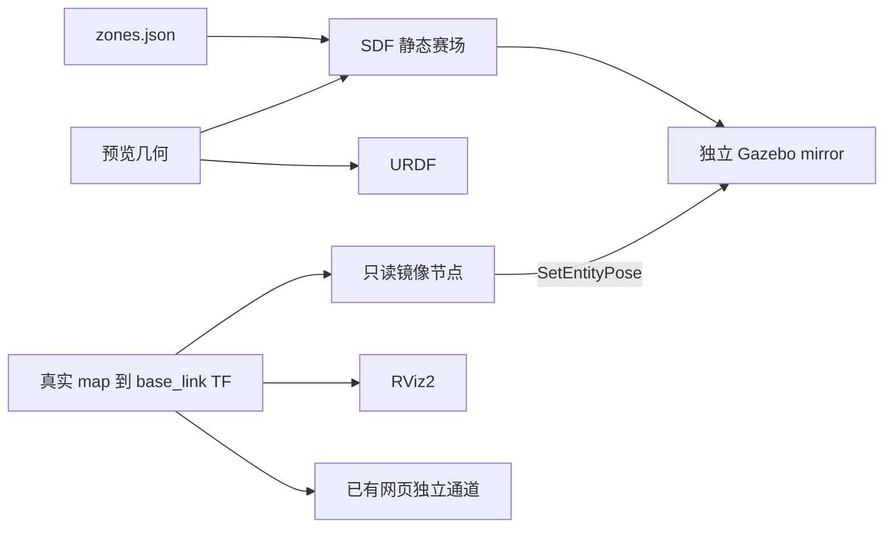
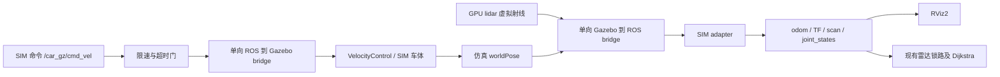
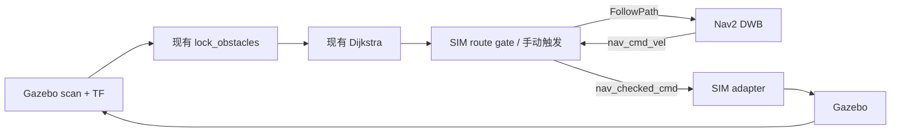

# 系统架构与所采用算法（源码对应版）

**基线**：`main@1a7a696b`，2026-11-22。本文区分 **当前真正运行的路径**、**已有但尚未接通的模块**、**旧 V5 历史路径**和 **模拟验证**。代码路径相对仓库根目录。

## 1. 分层与控制权

~~~mermaid
flowchart TB
  A[比赛任务与静态场地规则] --> B[ROS2 道路图 Dijkstra / 离线任务预览]
  C[雷达 /scan + TF] -.需实测定位与锁路.-> B
  B -.尚未授予实车执行权.-> D[未来 Pi 到 STM32 控制适配器]

  E[OpenMV H7 Plus: QR/颜色/圆盘/数字环] <-->|USART3 V4 ASCII| F[STM32F407: app_race / vision]
  F --> G[Race FSM / Pick FSM / RingAlign]
  G --> H[四轮速度环+位置环 / 舵机+步进]
  H --> I[实车麦轮与抓取机构]
  I --> J[编码器 / IMU]
  J --> F

  F -->|USART2 ULog43 单向遥测| K[Pi ROS2 car_stm32_bridge]
  K -->|/odom 等| L[REAL 只读网页]
  M[TEST mock MCU PTY / CAR-LINK] --> N[TEST ROS2 bridge] --> O[TEST 网页]
  P[浏览器 WASDQE] --> Q[localhost HTTP intent] --> R[PC ROS2 TwistStamped]
  R --> S[独立 ROS2 echo 订阅节点] --> T[MOCK 位姿积分] --> U[KEYBOARD 紫色车]
  V[浏览器五轴机构 MOCK] --> U
  W[SIM 本地模型] --> X[SIM 页面]
~~~

安全解释：

- **唯一已明确的真实执行者**是 STM32 固件自己的控制和机械流程。Pi/PC 的模拟任务、网页机构键、软件 ROS2 话题与“真实动作授权”是不同概念。
- `/real` 只接受真实来源的遥测；`/test` 与 `/real` 在 HTTP 内存通道和启动器中分离。网页安全隔离不构成密码学身份认证。
- `/keyboard` 的 `/car/teleop/local_test_twist` 用于 PC 上的软件回环。`/cmd_vel` 只读观察相关模块与测试并不意味着向实体 STM32 发送命令。
- 文档中的方框连线虚线代表**待实测/待开发**，不能当作已通的实体线。

## 2. STM32F407 / C30D 控制架构

### 2.1 业务、控制、驱动分层

| 层 | 主要文件 | 职责与边界 |
| --- | --- | --- |
| HAL 与调度 | `STM32F4/Core/Src/main.c`、`App/app_runtime.c` | 外设初始化、TIM6 时间基、主循环；不堆积视觉业务 |
| 轮电机 | `Control/Motor.c` | 编码器窗口测速、目标斜坡、PID/前馈/死区补偿、限幅、PWM 双路输出 |
| 麦克纳姆底盘 | `Control/mecanum_chassis.c` | 四轮正逆运动学、位置 PID、角度误差归一、世界/车体速度转换、里程计 |
| 航向/辅助里程计 | `Control/nav.c`、`Hardware/app_imu.c` | ICM20948 与轮式航向组合、打滑判断、静止零速修正 |
| 比赛总控 | `App/app_race.c`、`App/race_fsm.c`、`App/race_task_plan.c` | 启动/取消/故障/路线/二维码和夹取互斥 |
| 视觉帧 | `Hardware/vision.c/.h`、`Hardware/bsp_uart_router.c` | 唯一 USART3 HAL 回调路由、缓冲、XOR 帧验证和会话数据 |
| 圆环控制 | `App/app_ring_align.c` | 图像误差→车体小步、限幅、停稳/重测、超时与完成握手 |
| 机械抓取 | `App/app_pick_fsm.c`、`App/app_pick_motion.c` | PB14/PB15/PC7 舵机与 PC6/PC8/PC9 升降步进的非阻塞动作序列 |
| 日志 | `Hardware/bsp_ulog.c` / USART2 | ULog43 数值帧，一般作为只读遥测 |

### 2.2 实时周期

根据 [STM32 架构文档](../STM32F4/docs/ARCHITECTURE.md)：

~~~text
TIM6 1 ms：Motor_Update(每轮电机)
        └─ 累计 10 次：Mecanum_ChassisTick(10 ms 位置/速度目标)
主循环：IMU Poll → Vision_Poll → Race FSM → Pick FSM
      → 舵机/步进轮询 → 日志/显示，尽量非阻塞
~~~

注意不要把主机上能运行的 C 测试当成目标板已经稳定实现实际 1 ms 周期。串口中断里只做帧字节处理/转交，不能增加阻塞式识别或动作控制。

### 2.3 四麦轮运动学

源码 `Mecanum_InverseKinematics` 的约定中，车体纵向 `v_x`、横向 `v_y`、角速度 `ω`，`L = wheel_base_half + track_width_half`。四轮圆周线速度（先乘 `meter_to_pulse` 得到编码器脉冲每秒）是：

~~~text
v_LF = vx - vy - L*ω
v_RF = vx + vy + L*ω
v_LB = vx + vy - L*ω
v_RB = vx - vy + L*ω
~~~

逆推：

~~~text
vx = (v_LF + v_RF + v_LB + v_RB) / 4
vy = (-v_LF + v_RF + v_LB - v_RB) / 4
ω  = (-v_LF + v_RF - v_LB + v_RB) / (4L)
~~~

这是**当前源码符号约定**，真实车体的左右轮接线、电机方向宏和编码器方向仍要逐轮核对。`meter_to_pulse` 与 `pulse_to_meter` 来源于轮半径、每转编码器计数、减速比。

位置控制中，`x/y/θ` 分别由位置 PID 生成世界速度与角速度目标，`θ` 误差由 `Angle_Normalize` 折返到圆周最短方向，避免 ±π 边界“转一大圈”。运动前依当前航向把世界 `(v_x,v_y)` 转换为机体系，再做四轮速度分配。

### 2.4 电机速度环 / 抗抖和限幅

`Motor.c` 包括：
- 每约 5ms 的测速窗口（参数 `MOTOR_SPEED_WIN_MS=5`），编码器读增量→脉冲/s；一阶低通 `speed_lpf = (1-α)*old + α*raw`，当前 `α=0.35`。
- 目标斜坡约束 `MOTOR_TARGET_RAMP=4000`（脉冲/s²）；单轮 PID 的 P/I/D，积分限制；超过启动阈值时附加速度前馈和死区补偿。
- 卡住/静摩擦补偿 `kick`，输出变化率约束 `MOTOR_SLEW=30`（按测速窗口）；最后把有符号输出转换为双 PWM。
- `nav.c` 用 IMU yaw 差分估计角速度、与轮速角速度比较判断滑动；打滑时降低位移信任，并对静止状态进行零速抑制。

上述参数来自当前源码，**不是现场 PID 整定后的指标**；不应把网页平滑动画速度写成真实伺服速度。

## 3. OpenMV H7 Plus：视觉处理流程

当前实际相机包为 [四文件版](../algorithm/openmv/openmv_all/)，`config.py` 默认 `UART_PROTOCOL='V4'`，UART3 115200 8N1，QVGA 320×240 RGB565。历史 V5 可手动选择，但与 STM32 的协议实现要对应匹配。

### 3.1 QR 识别与任务编码

`Mission.scan` 灰度图调用 `find_qrcodes()`，要求合法四组三位码、各批颜色不重复且集合相同、环号为 1/2/3 排列；当前 `QR_CONFIRM_FRAMES=3`，连续确认才接受。任务码示例 `156+123+516+231`，任务规划区分“第一批粗加工环号”与“第二批暂存按第一批颜色找同色底座”，不可混为一谈。

V5 历史工作流能生成 24 次抓放 + 1 次返回；**当前默认 V4 不等于该 25 步都已和 STM32 实机对通**。

### 3.2 六色物料、转盘与抓取点

`MaterialDetector` 使用六组 LAB 阈值 + `find_blobs`（面积/边长/填充度）产生色块，再以 `find_circles` 的霍夫圆寻找物料圆顶，复核圆心区域色彩以降低误识别。

`DiskGate` 依据三个异色物料近似 120° 的几何布局估算圆盘中心，以圆盘边界亮度/对比度与盘心验证；盘面/轨迹比例参数为 `ORBIT_RATIO = 200/300`。此处**第一次锁盘**依赖三种颜色几何，不能仅因为用户希望“看到两个就可以”就宣称算法已支持二物块初始化；缺物后在锁盘历史附近重识别是另一种情况。

`MaterialTracker/Track` 按色彩和位置关联相邻帧目标，用两个一维 Kalman 估计 x/y 与运动速度，设置 `STILL_MS=550` 与 `SLOT_HOLD_MS=150` 等稳态条件。抓取像素默认 `PICK_TARGET=(160,190)`、容差 12 px，**尚非现场标定**；必须和实际机械夹爪几何共同核验。

### 3.3 数字环与遮挡

`RingDetector` 灰度暗环候选+径向多方向采样，验证多道同心暗边；数字压缩为 5×7 黑白网格做模板匹配，支持 0/90/180/270° 模板旋向比对，最优得分阈值 `0.74`、领先差值 `0.05`。`StationVision` 对遮挡数字优先读其他两环并利用等间距关系推断，要求第三环外缘仍得到验证；完全遮挡需按粗加工区/暂存区分开标定 `COVERED_WINDOWS`，当前默认全部 `None`。

### 3.4 圆环视觉闭环（STM32 接管运动）

相机给 `(dx,dy)` 像素误差；STM32 上 `app_ring_align.c` 由标定矩阵

~~~text
[dx]   [J00 J01] [Δx]
[dy] = [J10 J11] [Δy]
~~~

求逆得到下一次机体系微调 `-gain·J⁻¹·e`，若超最大步长则等比限幅，过小的有效步有最小步长处理；到位多帧确认、运动停稳再触发 `STEP_DONE` 复测，最后 `ARRIVED` 收口。当前 `race_config.h` 中 `J00/J01/J10/J11 = 0`，`det(J)=0` 会通过安全门**拒绝真实自动微调**。不允许随意填“经验矩阵”绕过门控。

## 4. ROS2、地图与任务规划

### 4.1 地图与禁行不是同一个图层

赛场物理地图（`competition_navigation_map.yaml`）描述真实障碍；规则 keepout 掩膜描述不允许驶入的区域。物理占据图与规则禁行应该分别加载到 Nav2 对应功能，不能因为有 `.pgm` 就认定机器人会自动避开黄色禁区。地图 V6 核对版把原料盘上边界外的 358 个栅格错误从 occupied 修为 unknown，**但并未自动替换正式地图**。场地随机障碍/QR 板位置不能硬编码。参见 [V6 地图核对](../algorithm/car_ws/maps/competition_v1/v6_static_preview/README_静态场地地图核对版.md)。

### 4.2 Dijkstra 规则路径

`road_topology.py` 给出道路节点与边，`rule_mission_core.py` 只读复用 `canonical()` 和 `plan_mission()`，按九个比赛站点生成八段路径。若封锁边不存在、规划不可达、道路状态未 `LOCKED_READY`、`source≠LIDAR_CONFIRMED`、`frozen≠true` 或状态冲突，就拒绝输出真实可用路径。`/competition/station_poses` 只是未来可靠工位观测接口，项目还没有完成雷达对转盘与 QR 板的实测定位发布。

拓扑级 Dijkstra **不能直接当电机轨迹**：道路节点不是精确停车位，尚需机器人占据半径、TF、定位误差、速度约束和闭环执行器。

### 4.3 SIM_ONLY 比赛执行

`mission_execution.py` 解析任务码和八段路径，编译成带 `cmd_id` 的动作意图。`SimExecutor` 同时最多一条在途命令；`ACK` 只表示受理，`COMPLETED` 才推进步骤；超时、拒绝、失败或旧序号/重放产生故障或拒绝。可用 `mission_sim_demo.py` 模拟完整抓放统计，**不是实际机械抓放**。

## 5. 四模式网页和键盘/机构算法

### 5.1 一套前端，不是四套复制工程

`sim2real/web/index.html` + `app.js` + `mode_router.js` 为共享页面；后端 `server.py`/`web_mode_gateway.py` 与桥接进程分离 TEST / REAL。SIM 的本地状态、TEST 的 PTY 假 MCU、REAL 的只读硬件遥测、KEYBOARD 的本机 ROS2 回环分别标注来源，未收到真实来源就应显示离线。

### 5.2 WASDQE→MOCK 车体运动学

浏览器按键产生候选 `base_link` 速度，通过 localhost API `/api/keyboard/intent` 供 `keyboard_ros2_pc.py` 读入并发布 `TwistStamped` 到 `/car/teleop/local_test_twist`；`keyboard_ros2_web_feedback.py` 独立订阅后回写 `/api/keyboard/ros2_feedback`。仅订阅到有效 PC ROS2 速度且 deadman/TTL 满足时，`KeyboardChassisTwin(mode='direct')` 才在网页上积分：

~~~text
θ_mid = θ + ω Δt/2
x' = x + (cos θ_mid · vx − sin θ_mid · vy) Δt
y' = y + (sin θ_mid · vx + cos θ_mid · vy) Δt
θ' = wrap(θ + ω Δt)
~~~

这是刚体速度的近似数值积分，**不包含真实轮胎、电机加速度、碰撞与实车 /odom**。直通模式没有旧的 Shift 使能、障碍锁停、任务故障 FSM 或地图边界禁行。旧 `physics` 模型另保留为离线故障测试，不能把它说成默认键盘行为。按键有效期的候选 TTL 当前约 300ms。

针对 UI 抖动，当前保留既有 HTTP/ROS2 流程，只在最终 SVG 坐标层用 `smoothPose` 平滑；它不改变真正的 ROS2 数据、也不授权电机。用户截图中 `NO_KEYS_OR_TIMEOUT` 在未按键时属正常待命，是否已收到按键要结合网页捕获状态与 ROS2 echo 状态诊断。

### 5.3 五个浏览器机械 MOCK 轴与补帧

`keyboard_mechanism_preview.js` 定义五轴：
`column_yaw_deg`（升降柱绕竖直轴 ±180° 模拟）、`tray_deg`（PC7 三工位托盘）、`lift_mm`、`holder_deg`、`grip_deg`。`keyboard_mechanism_mapping.js` 维护长按键、预设、相反方向抵消、失焦清键；这些操作只更新浏览器内存目标。

补帧算法 `advance()` 每次以 1/120 秒以内的分段步推进，使用“到目标剩余距离”估计可制动速度，`v_des = sign(e)·min(v_max, sqrt(2a|e|))`，再用 `aΔt` 限制速度变化，最后更新当前显示角度/位移，防止突然启停。固件名义 `firmwareRate` 与网页 `previewRate/previewAccel` 分开。长帧最大可推进的可视化时间受到约束，防止浏览器后台恢复时跳跃。

几何层 `computeMechanismPose` 把机构状态投到 SVG：升降柱/滑台/夹爪为同一个旋转组 `columnTurn`，独立于 PC7 车尾托盘；`projectColumnSide` 用带符号余弦投影，让 180° 时夹爪移到立柱另一侧。SIM/TEST/REAL 的车体轮廓是**固定未测量结构示意**，不证明实车五轴位置。

## 6. 工程设计的核心原则

- **业务状态机 ≠ 物理闭环**：动作完成必须靠有来源、序号、时效的执行反馈，而非 HTTP 成功或模拟回执。
- **串口接收与运动执行分离**：HAL IRQ 不做耗时运算，解析和业务动作留在主循环。
- **控制权单点**：STM32 不能多套 PID 争抢底盘目标；视觉闭环活动期间比赛调度不应同时发另一段位置命令。
- **物理坐标/像素坐标区分**：px、mm、m、deg、rad、encoder pulses/s 严格带单位，标定矩阵与坐标系不能省略。
- **数据血缘可追踪**：REAL/TEST/MOCK 与 Pi 候选消息必须显式标记，不可跨源兜底冒充。
- **硬件安全优先**：未知舵机、线束、零位、限位，所有新功能只允许模拟显示，不能因为网页多了滑块就发实机动作。

延伸：[通信与数据流](PROTOCOLS_AND_DATA_FLOW.md) · [当前进度](PROJECT_STATUS.md) · [验收计划](ROADMAP_AND_ACCEPTANCE.md)。

## Gazebo 三维通道

### 共享几何和 REAL 镜像

新增 `algorithm/car_ws/src/car_gazebo/`，不依赖网页，也不改 STM32/OpenMV。URDF 与 SDF 共享同一份预览车体几何；SDF 场地由现行 `maps/competition_v1/zones.json` 生成，黄色、蓝色和工位为视觉层，真实原料盘及显式模拟障碍有碰撞体。世界原点与比赛 map 左下角一致。轮半径 0.04m、前后半轴距 0.093m、左右半轮距 0.11m 取自 STM32 源码，其他预览外形非实测；未写入雷达、相机外参和机械关节假值。

镜像仅取真实 ROS2 图中 0.5s 内的 map 到 base_link TF；以平面 x/y/yaw 设置模型位姿，过期或异常则保留上次显示并告警。镜像世界不生成假障碍，不发布 /scan、/odom、/tf 或 /clock，不下发电机命令。REAL 镜像是**只读三维显示**，不提供虚拟雷达或物理控制，且禁止在专用 SIM 域 84 中启动。后续须验证 Fortress 实体服务、统一模型尺寸、实车 TF 来源及动态仿真数据隔离。

### 全向 SIM 数据链（代码候选）

Fortress VelocityControl 直接接收车体速度，不伪装真实麦轮滚子动力学；OdometryPublisher 读取 worldPose，GPU lidar 从虚拟场景产生 360° 扫描。仿真激光高度 0.092m 是工程假设（低于 0.10m 模拟障碍柱顶），不可写入实车外参。SDF 碰撞包络为 0.266×0.25×0.085m，质量暂设 2kg，仅仿真用；URDF 外观与 SDF 共用车体几何。包络长度取 max(底板长度, 2×(前后半轴距+轮半径))，宽度取 max(底板宽度, 2×左右半轮距+轮宽)。Nav2 足迹使用同一外包尺寸，另加 10mm footprint_padding；不是实车测量数据。

单独 ROS_DOMAIN_ID=84、ROS_LOCALHOST_ONLY=1、car_sim_* Ignition partition；真实/网页/TEST 不进入该域。SIM 仿真时钟通过 world clock 单向桥接。SIM 的 map=world=odom；odom→base_link 取仿真位姿，base_link→laser_frame 由 SIM URDF 的 robot_state_publisher 唯一发布。轮位姿根据理想 X 型麦轮逆运动学积分，仅 RViz 关节动画；Gazebo 轮视觉固定。令 L=0.093、W=0.11、r=0.04，车体速度 (vx,vy,ω)，a=(L+W)ω，则四轮角速度为 (vx−vy−a, vx+vy+a, vx+vy−a, vx−vy+a)/r。非实测轮方向。指令按二维速度范数 0.20m/s、角速度 0.50rad/s 限制；0.30s 指令过期或任一仿真数据超过 0.50s 返回零。VelocityControl 自身会保持最后指令，故 launch 监督任一子进程退出即关闭本次仿真，不作为硬件急停。

现有道路锁定/拓扑算法可以在独立 SIM 域使用仿真 scan/TF，单段路径执行见下节；当前不改动真实导航配置、速度桥或避障代码。依据：[Fortress VelocityControl](https://gazebosim.org/api/sim/6/classignition_1_1gazebo_1_1systems_1_1VelocityControl.html)、[OdometryPublisher](https://gazebosim.org/api/sim/6/classignition_1_1gazebo_1_1systems_1_1OdometryPublisher.html)、[GPU lidar](https://gazebosim.org/docs/fortress/sensors/)。

### 锁路到 Nav2 执行（SIM 候选）

复用原有 lock_obstacles.py 与 road_topology.py；前者已修复圆周接缝和扫描/TF 同步，后者拓扑规划算法不改动。新 sim_nav.launch.py 在独立本地域启动物理 /map、规则 /keepout_filter_mask、锁路、Dijkstra、Nav2 controller 与 route gate。Gate 同时检查 LOCKED_READY、LIDAR_CONFIRMED、冻结且无冲突、两条话题的节点坐标与已有拓扑相符、经过的边未被锁定，且仿真位姿在首节点 0.06m 内。只在用户显式触发后，对冻结路线逐边生成按 0.025m 最大间距插值的路径，依次发送 FollowPath action；将 wall-time 预览路径重新标记为 SIM 时间。执行时持续核对原始锁路心跳与派生道路/路径状态、仿真 scan/odom/clock 时效；不一致立即封锁速度并请求取消。SIM 时钟回退会锁存故障，必须重启导航以丢弃旧锁。Nav2 action 成功且终点仿真里程计误差≤0.06m 才报告成功。

DWB 允许 vx/vy 正负，使用独立 1cm local costmap、矩形临时 footprint、规则掩膜 StaticLayer 和真实的仿真 LaserScan obstacle layer。原实车 Nav2 参数不变。SIM adapter 的 command_source 固定选择 manual 或 nav2：后者只消费 nav_checked_cmd，直接手动命令不会参与。当前每次显式执行一条锁路路线（逐边执行，交叉节点停稳后续行），不自动推进两批比赛任务；连续安全净空、全部场景和实车标定仍须验证。Humble 接口依据：[FollowPath action](https://api.nav2.org/actions/humble/followpath.html)。

### 联合启动与运行验收

`bash/gazebo.sh` 管理独立 SIM 会话：自定位工作空间、检查依赖、拒绝重复实例及已占用的 ROS 域 84，生成独立临时世界并启动 `sim_full.launch.py`。后者组合已有 Gazebo 和 Nav2 launch，以及预设 RViz2 显示；不复制算法。启动检查 `check_sim.py` 必须实际收到递增的时钟、里程计、扫描及轮关节数据、有效 TF、地图与掩膜、双障碍锁定及一致路径、ACTIVE controller 和零速度，才输出 READY。正常 start 不发车；test 显式触发 SIM action，检查到站结果、仿真位姿误差≤0.06m、零驱动指令及静止里程计。启动失败或退出只清理本次管理的进程组，保留场景和日志；不会清理真实雷达、网页、STM32 或其他用户进程。独立 GitHub Actions 使用 Ubuntu 22.04/Humble、Fortress、Nav2 与无界面渲染执行 C3→C2、C3→A1 两个独立运行用例；它不替代实体车、桌面 RViz/Gazebo GUI 或全部场景的验收。

## 跨电脑路径设计

以脚本所在真实目录（Bash BASH_SOURCE + pwd -P，Python Path(__file__).resolve()）作为默认锚点，不依赖当前目录及用户名。命令行显式参数优先；支持的设备级环境覆盖列于操作文档；缺省时才从项目定位或采用标准系统安装位置。指定不存在的 SDK 不回退为另一版本。ROS2 节点的已安装资源仍通过 ament_index 查找。ROS setup 可覆盖且使用 Humble，临时关闭 nounset 处理 ROS setup 的变量探测，之后恢复调用者 shell 状态；不得在已激活 Conda/venv 中加载。V6、Gazebo、web/keyboard 等入口保留既有数据与运动边界。旧 Nav2 YAML 的比赛行为树路径在部署时解析为绝对路径写入独立生成文件，不改变行为树、DWB 或恢复策略。雷达重建普通安装避免依赖源树/构建目录的符号链接；SDK 缺失时不默认下载，显式允许才构建本地 SDK。ROS 构建产物依然可能含绝对路径、ABI 和架构相关内容，迁移必须重建，源码可移植不等于二进制可移植。

### PC / Pi5 部署配置及构建边界

部署入口 `bash/deploy.sh` 读取 uname -m 并限定原生 64 位架构；pc 对应 x86_64、pi5 对应 aarch64，两者复用同一组 12 个自有 ROS 包（接口、只读串口/遥测、视觉/机构/任务监视、导航及网页适配），sim 单独选 car_navigation、car_gazebo。通过 package.xml 获取已声明的 ROS 依赖，以显式 --base-paths 和 --packages-select 限制 colcon 发现范围，不扫描整个旧雷达工作区或实验包。构建时拒绝可识别的过期 CMake source/build 路径与错误架构的编译器 ABI 缓存；verify 检查每个包的本地 isolated install 前缀及代表性可执行文件的 64 位 ELF e_machine（x86_64=62、AArch64=183）。test 执行包内软件测试及静态地图路径 probe，不启动传感器或控制节点。Pi5 的 YDLIDAR SDK/驱动、实测 TF 和 STM32/OpenMV 设备通信独立验收。部署检查不是自动安装器，不能修改全局软件环境。ARM64 CI 使用实际 ARM64 runner，不等同 Raspberry Pi 5 实机验收；真实 colcon 构建路径含空格的兼容性仍未证实。

### 雷达全周扫描接缝

原聚类沿 ranges 顺序分组，±π 接缝可将同一紧凑目标拆成两段；C3 仿真用例中 (1.5,2.05) 相对雷达恰好位于后方。修复先保留连续有效点段，只有全周扫描（步长不超过 0.1 rad，总跨度与 2π 差不超过 1.01 个角步长）、首尾读数有效且端点距离不超过原邻接阈值时才连接首尾。包含重复首尾角度的扫描去掉重复采样后再判断最少点数和包围盒对角线，不把重复射线视作独立证据。部分视场、无效端点、大跨度目标不合并为有效小目标。原匹配半径、确认次数、封路规则、速度门均不改；冲突新增扫描元数据、地图候选和确认轨迹日志用于追溯。解析圆柱射线用例验证假设，真实 Gazebo 原因仍需通过运行日志确认，真实雷达也需静止标定复测。

### 扫描与 TF 同步（锁路节点）

旧实现单线程 executor 的扫描回调内 lookup_transform(timeout=0.1s) 同步等待，而 TransformListener 的 TF 回调也依赖该 executor；在 10 Hz 扫描时可能持续阻塞并形成排队。[运行 CI #45346142970](https://github.com/David-tiao/car/actions/runs/45346142970) 实测重复 future extrapolation（例如扫描 t=43.7s，TF 最新 t=41.922s），这是本次运行失败的直接现象，回调阻塞是待运行验证的机制解释。

新实现：/scan → 严格递增非零时间戳及基础元数据校验 → 16 帧 FIFO → 20 ms steady timer 非阻塞查询 map←laser_frame(scan stamp) → 仅成功时消费 → 地图过滤/原聚类/轨迹确认。每 tick 最多处理 4 帧；等 TF 不超过 0.5 s wall，溢出丢弃最旧，重复或乱序不累计 hits。没有 TF 时让出 executor，不退化到 Time(0)，不使用虚构位姿；冲突仍保持锁路冻结并停止确认。状态新增 scan_tf_ready（最后有效变换处理距今≤0.5 s）、scan_tf_stamp_ns、scan_tf_processed、scan_queue 计数。SIM gate 除原双障碍和路径契约外要求真 scan_tf_ready、合法整数 stamp、相对于 /clock 的差在 [-0.1,1.5] s（包含 1 Hz 锁路心跳间隔），完成 action 时再次核对契约。原锁路数量、匹配参数和运动上限不改；实车控制仍禁用。

### 多道路边逐段执行与二维节点判据

整条路线一次交给 DWB 时，[45358283320](https://github.com/David-tiao/car/actions/runs/45358283320) 的 A1 用例发生 791 条候选均无效；改为逐边后，[45358957899](https://github.com/David-tiao/car/actions/runs/45358957899) 第二边在 B2 附近 3.7cm 位置误差时发生 progress checker 中止。现有九站道路节点只定义 x,y，不要求指定 yaw。新独立 road_node_checker 使用 Humble SimpleGoalChecker 的 xy_goal_tolerance=0.04m、yaw_goal_tolerance=π、stateful=false；原 goal_checker 的 0.04m/0.12rad 保留用于明确朝向的任务。仅 SIM 配置变更，不是实车姿态标定。失败原因日志包含 pose、target、yaw、speed，不把失败 action 转成成功。

显式触发 → 验证冻结全路径 → REQUESTED → FOLLOWING → SETTLING：每边必须 Nav2 SUCCEEDED、该边终点误差≤0.06m、持续零令至少0.15s、收到结果后的新 odom（线速度≤0.025m/s、角速度≤0.05rad/s），3s 内满足才累加 completed_segments 并发送下一边；全路线仍受 120s 上限与连续 lock/TF/scan/odom/clock 门约束。状态变更或超时阻断速度并取消活动 action，不自动绕路。验收额外要求 completed_segments=total_segments=锁路节点数−1。

99fcf34 已验证：[双路线运行 CI #45359460287](https://github.com/David-tiao/car/actions/runs/45359460287) 两组独立 Fortress/Humble 实际运行均 PASS；锁定 B2-B3、B3-C3，C3→C2 1/1 路段、终点误差 0.0387m；C3→C2→B2→A2→A1 4/4 路段、终点误差 0.0374m；均零驱动与静止里程计。[原生双架构 CI #45359460641](https://github.com/David-tiao/car/actions/runs/45359460641) x86_64/ARM64 12 包原生构建及 ELF/包前缀、2 测试、地图 probe PASS；[全量离线 CI #45359460151](https://github.com/David-tiao/car/actions/runs/45359460151) PASS。 这证明固定场景的实际闭环，不证明整个连续轨迹净空、所有障碍布局、桌面 GUI 或实车安全。

### Gazebo 双后端适配

`gazebo_backend.py` 是唯一后端能力表：Fortress（Sim 6、ignition-transport11、ignition-msgs8、ign gazebo）、Harmonic（Sim 8、gz-transport13、gz-msgs10、gz sim）。先从当前 ROS overlay 的 ros2 pkg prefix 定位 parameter_bridge，检查真实 ELF 的 ldd 递归依赖是否匹配且无缺失库，再检查目标 simulator major 是否可用；auto 按桥接 ABI 选模拟器，显式请求不匹配则失败，不根据机器名称或仅有 gz 命令来猜测。已选择的模拟器命令固定 major，避免共存多个 major 时误选。传入 generator 和 launch 的 backend 必须一致，launch 再检查 SDF plugin namespace 和桥接 ABI。两种场景共用原始几何、参数、话题及模型；Harmonic 仅转换 gz-sim 插件文件名/类名、gz_frame_id，ROS bridge 仅替换 ignition.msgs/gz.msgs。两种 Transport 环境变量设置同一独立分区，避免旧环境别名串扰。三条仿真→ROS 与一条 ROS→仿真单向桥接、域84本地隔离、TF 门控、锁路、逐边 FollowPath、速度与停车校验均保持不变。无须修改真实驱动、STM32 或 OpenMV。镜像服务端仍另行验收。

官方依赖说明：[Humble/Harmonic 配对](https://gazebosim.org/docs/harmonic/ros_installation/)、[Harmonic 安装](https://gazebosim.org/docs/harmonic/install_ubuntu/)、[ROS bridge 消息](https://gazebosim.org/docs/harmonic/ros2_integration/)。Humble 默认 Fortress，OSRF 提供替代 Harmonic 二进制包，两套桥接包可能冲突。禁止在工作站无授权自动替换。[全量离线 CI #45384544126](https://github.com/David-tiao/car/actions/runs/45384544126) PASS，[双后端四路线运行 CI #45384544228](https://github.com/David-tiao/car/actions/runs/45384544228) 四个独立后端/目标组合仅在实际运行通过后标记对应 PASS；不把 SDF 离线等价测试视为运行验证。

2c56861 实际运行验收：[四组合 CI #45384544228](https://github.com/David-tiao/car/actions/runs/45384544228) 全部 PASS。Fortress C3→C2 1/1、0.0375m；Fortress C3→A1 4/4、0.0385m；Harmonic C3→C2 1/1、0.0377m；Harmonic C3→A1 4/4、0.0382m。均实测锁定 B2-B3、B3-C3，驱动归零、静止里程计。[双架构 CI #45384544069](https://github.com/David-tiao/car/actions/runs/45384544069) 两组 PASS；[离线 CI #45384544126](https://github.com/David-tiao/car/actions/runs/45384544126) PASS（14 场景、18 锁路、12 移植及原全量回归）。无界面固定场景，不代表本机 GUI、真实镜像或实车验收。
